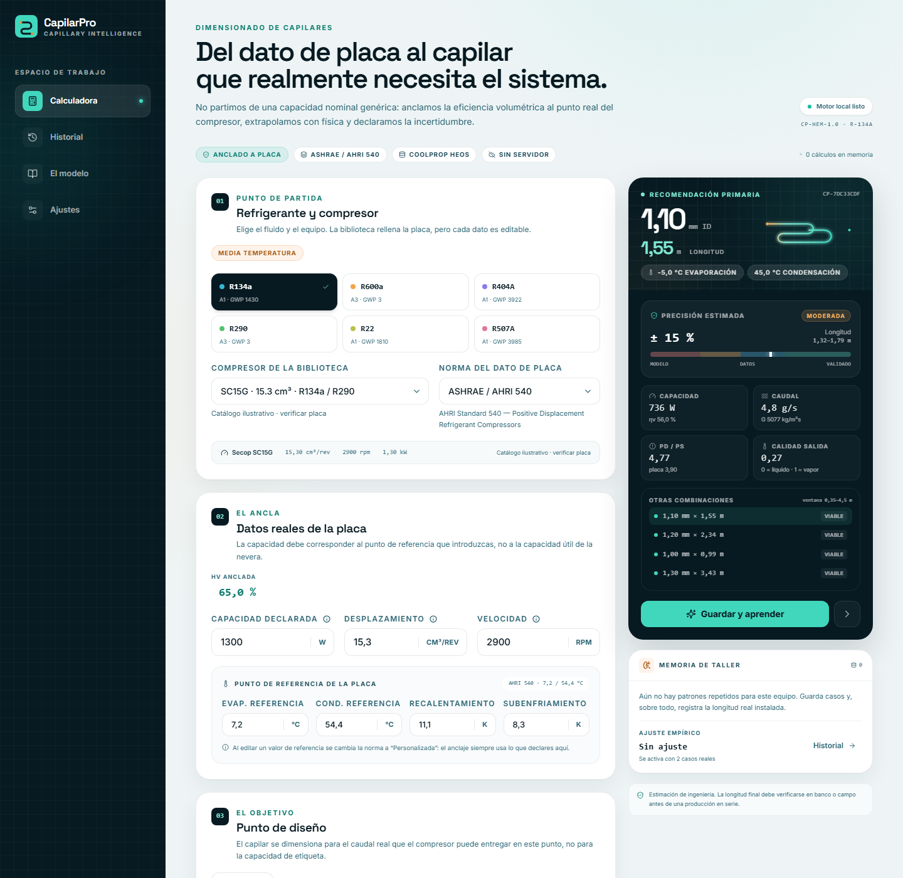

# CapilarPro

Dimensionado de tubos capilares para refrigeración por compresión, anclado a los datos reales de la placa del compresor, con física trazable e incertidumbre declarada. El cálculo se ejecuta en el navegador y es completamente efímero: no se almacena ni se transmite ningún dato.



## Qué resuelve

La mayoría de las hojas de cálculo parten de una capacidad nominal genérica y aplican una tabla fija de eficiencia volumétrica. CapilarPro hace lo contrario:

1. Toma desplazamiento, frecuencia de red (50/60 Hz) y capacidad **en el punto de referencia de la placa**; para el compresor estándar de 2 polos calcula RPM = Hz × 60.
2. Despeja la eficiencia volumétrica real de ese compresor.
3. Extrapola la eficiencia al punto de diseño mediante el volumen nocivo.
4. Resuelve el capilar con un modelo 1D adiabático sobre la curva de saturación.
5. Declara la incertidumbre del modelo y permite comparar con las medidas instaladas durante la sesión.

El resultado es una recomendación de diámetro interior comercial × longitud, con alternativas y una banda de confianza, no un número aislado.

## Funciones principales

- **Anclaje a placa**: capacidad en W o BTU/h, desplazamiento en cm³/rev o in³/rev, frecuencia de red (50/60 Hz) y condiciones de referencia editables. El motor normaliza las unidades antes del cálculo.
- **Condiciones por aplicación**: perfiles LBP, MBP y HBP ajustan evap. y cond. según ASHRAE, EN 12900 o GB/T. El recalentamiento de ensayo se deriva de temperatura de retorno menos evaporación y el subenfriamiento de condensación menos ambiente; ambos son de solo lectura salvo que el usuario habilite la edición manual.
- **Punto de diseño**: evaporación y condensación objetivo con deslizadores e introducción exacta, temperatura de retorno y ambiente; el motor deriva el SH operativo y avisa si el salto térmico del condensador es bajo.
- **Intercambiador SLHX opcional**: el modelo ε-NTU aplica una efectividad configurable y recalcula el estado de succión, el caudal y el capilar en vivo.
- **Extrapolación física**: eficiencia volumétrica con volumen nocivo efectivo derivado del punto medido.
- **Modelo de capilar**: integración 1D, calidad local por balance de energía, fricción de Darcy, viscosidad homogénea y multiplicador bifásico.
- **Incertidumbre honesta**: propagación RSS de modelo, capacidad, tolerancia dimensional, evidencia y propiedades.
- **Sesión efímera**: entradas y resultados viven solo en memoria; al recargar, vuelven los valores de fábrica.
- **Interfaz en español**, responsive y con panel de resultados fijo en escritorio.

## Refrigerantes y normas

| Refrigerantes | Normas de referencia |
| --- | --- |
| R134a, R600a, R404A, R290, R22, R507A, R407C, R417A, R422D, R427A | AHRI 540, EN 12900, AHRI histórico / ARI y condición personalizada |

Las propiedades de saturación se generan desde **CoolProp 6.6.0 (HEOS)** y se versionan en `src/data/refrigerantTables.json` con paso de 1 K. R407C usa su fluido HEOS; R417A, R422D y R427A usan sus composiciones másicas nominales como mezclas HEOS de componentes. La tabla de R427A comienza en −40 °C, límite de transporte disponible en esta versión. El motor usa la curva de rocío para la aspiración y la de burbuja para la condensación y el líquido subenfriado. El aviso de la interfaz recuerda cargar mezclas zeotrópicas en fase líquida. R438A no se ofrece todavía: HEOS 6.6 no tiene los parámetros de interacción necesarios para generar una tabla completa validada. El motor interpola las tablas en el navegador; no carga WASM en tiempo de ejecución.

## Cómo calcula

### 1. Eficiencia volumétrica anclada

Con el caudal barrido y las propiedades de aspiración/líquido en la referencia:

```text
RPM   = frecuencia [Hz] · 60 (compresor de 2 polos)
V̇    = Vd · RPM / 60
ηv,ref = Q0,ref / [V̇ · ρs · (hs − hl)]
```

Después se despeja el volumen nocivo efectivo `c` del modelo:

```text
ηv = 1 − λ − c · [(Pd/Ps)^(1/n) − 1]
```

Así la extrapolación conserva la eficiencia real del compresor en la placa y solo escala por relación de presiones. No se usa una tabla genérica de ηv. Si la capacidad de placa implica una eficiencia fuera del rango físico, la app la limita y **avisa** en lugar de ocultarlo.

### 2. Intercambiador succión-líquido (SLHX)

Al activar el SLHX, el usuario selecciona la fracción del capilar que se enrolla sobre la línea de succión (30–70 %) y el diámetro comercial de esa línea. La tabla editable de coeficientes U por diámetro está en `src/data/slhx.json`. El motor estima la longitud requerida para una efectividad de diseño de 0,7 y la limita a la fracción disponible del capilar:

```text
Cmin = ṁ · cp,vapor
Lreq = −ln(1 − 0,7) · Cmin / (U · π · Dsuc)
Lenrollar = min(Lreq, Lcapilar · porcentaje / 100)
εreal = 1 − exp(−U · π · Dsuc · Lenrollar / Cmin)
```

La efectividad real limita el calor transferido entre las corrientes; el motor ajusta las entalpías de succión y de entrada al capilar e itera el caudal y la longitud hasta converger, con un máximo de 20 iteraciones. Los coeficientes U son valores aproximados de configuración y no sustituyen datos de ensayo del intercambiador instalado.

### 3. Capilar 1D adiabático

Para cada diámetro comercial se integra la caída de presión a lo largo del tubo:

- balance de energía de estancamiento para la calidad local;
- densidad de mezcla homogénea;
- viscosidad dinámica ponderada por masa;
- factor de fricción de Darcy (laminar/turbulento);
- pérdida de entrada y multiplicador bifásico documentado.

La longitud que agota la presión objetivo es la predicción. El motor compara los diámetros comerciales, descarta longitudes fuera de la ventana práctica y ordena las alternativas.

### 4. Incertidumbre

Las contribuciones se combinan en cuadratura (RSS):

```text
σ_total = sqrt(σ_modelo² + σ_capacidad² + σ_diámetro² + σ_temperatura² + σ_propiedades² + …)
```

El margen empírico es fijo y no cambia con los datos introducidos durante el uso.

## Stack

- React 18 + TypeScript
- Vite 6
- TailwindCSS
- Zod
- Vitest + Testing Library
- Datos generados con CoolProp 6.6.0 HEOS

## Desarrollo

Requiere Node.js 20 o superior.

```bash
npm install
npm run dev
```

La app queda disponible en `http://localhost:5173`.

### Scripts

| Comando | Descripción |
| --- | --- |
| `npm run dev` | Servidor de desarrollo |
| `npm run build` | Type-check + build de producción |
| `npm run preview` | Previsualiza el build |
| `npm run lint` | ESLint |
| `npm test` | Tests del motor, datos y UI |
| `npm run data:validate` | Valida catálogos y tablas termofísicas |
| `npm run data:properties` | Regenera las tablas desde CoolProp |

### Tests

```bash
npm test
npm run data:validate
npm run lint
npm run build
```

Los tests cubren propiedades, anclaje de ηv, modelo de capilar, incertidumbre, fingerprint, esquemas Zod y flujos de la interfaz.

## Estructura

```text
src/
  components/     UI, layout, tarjetas, modales y tests de integración
  data/           Catálogos JSON y tablas termofísicas versionadas
  engine/         Propiedades, capilar, ηv, incertidumbre, normas, fingerprint
  lib/            Formateo y utilidades
  pages/          Calculadora y Modelo
  store/          Estado volátil y validación del formulario
  types/          Contratos TypeScript
  App.tsx         Router por hash y límites de error
  main.tsx        Punto de entrada
scripts/
  generate-properties.mjs   Genera tablas CoolProp
  validate-data.mjs         Validación de datos para CI
```

La navegación usa hash routing (`#/`, `#/model`) para funcionar en cualquier hosting estático, incluido GitHub Pages bajo subruta.

## Despliegue

El workflow `.github/workflows/ci.yml` valida datos, ejecuta tests, lint y build, y publica `dist/` en GitHub Pages cuando se hace push a `main`.

1. Sube el repositorio a GitHub.
2. En **Settings → Pages**, selecciona **GitHub Actions** como origen.
3. Haz push a `main`.

El `base: './'` de Vite permite servir la app desde la raíz o desde una subruta sin configuración adicional.

## Privacidad

Esta app no guarda ningún dato. Todos los cálculos son efímeros y permanecen en memoria durante la sesión. No hay almacenamiento local, llamadas a servicios de datos ni sincronización remota.

## Límites de ingeniería

CapilarPro es una **herramienta de estimación**. No es CFD, no modela metaestabilidad, aceite, curvas de retorno, fugas, geometría/UA del SLHX ni la instalación completa. El SLHX usa la efectividad ε indicada por el usuario. La longitud final debe verificarse en banco o campo antes de una producción en serie.

La biblioteca de compresores incluida es ilustrativa y debe contrastarse siempre con la placa o el catálogo del fabricante. Las tablas de propiedades son una interpolación de CoolProp; para condiciones críticas o mezclas con glide pronunciado, verifica con la fuente original.

## Licencia

MIT. Consulta [LICENSE](LICENSE).
